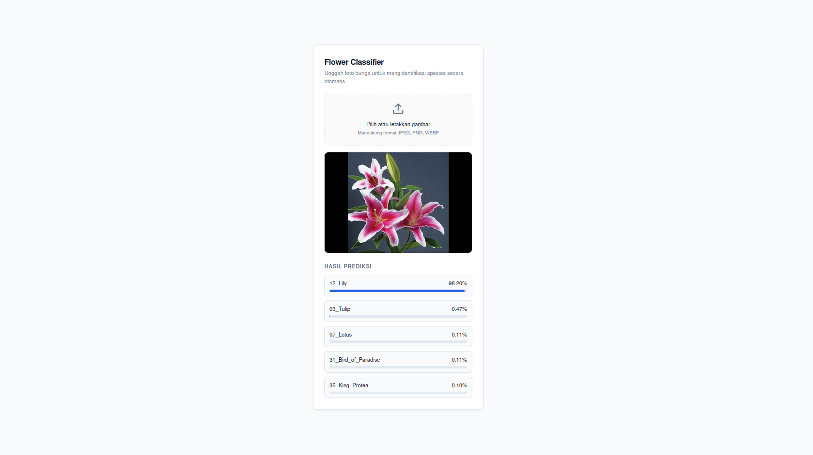

## Main Information

Freesia is a simple website that lets you upload a flower photo and immediately see what kind of flower it is.

## How to use

git clone https://github.com/VirzaPixel/Freesia_simpleWeb

-- (U NEED MODEL HAHAHAHA FOR WEBSITE TO WORK, U CAN SAY TO VIRZA TO GIVE THE MODEL)

run and open index.html on brower 

## Preview

